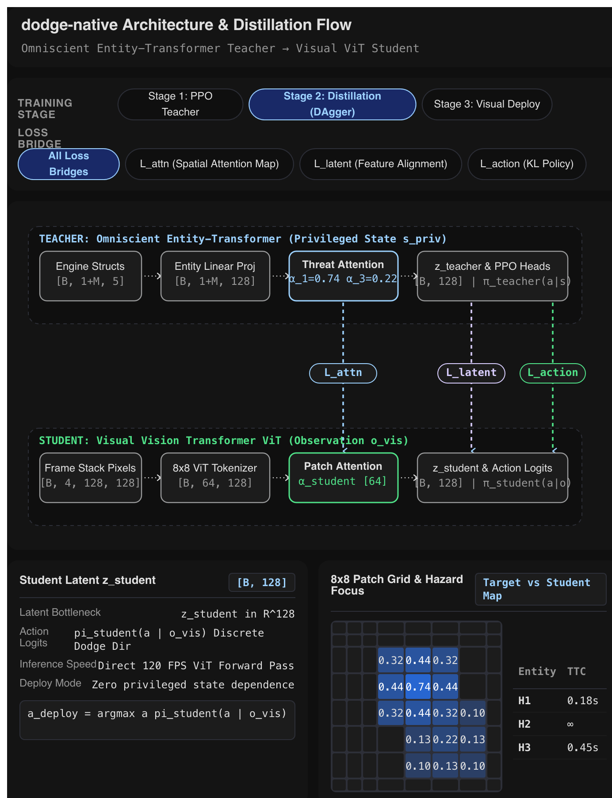

> Historical implementation and diagnostics: superseded by the user-supplied [v2.0 specification](SPEC_PRIVILEGED_VIT_RL.md). Retained for provenance; its objectives, feature contracts, architecture, and gates are not the current plan.

# Entity-transformer teacher and visual ViT student

The user-supplied architecture diagram defines the model contract. It supersedes the earlier small, filtered-state MLP proposal. The original [privileged-information brief](Training-Vision-Models-Using-Privileged-Information.md) remains preserved verbatim.



## Model contract

1. Train an omniscient entity-transformer actor/critic with PPO on privileged engine state.
2. Freeze the teacher and train the visual ViT using policy, latent, and spatial-attention supervision. Collect teacher labels on student-visited states through bounded DAgger rounds.
3. Deploy only the image policy. Engine state, teacher features, losses, and PPO value heads are absent from its input.

The teacher is a transformer over structured entities. It does not need an image branch. The student is a Vision Transformer over image patches. Neither the earlier MLP teacher nor a proposed multimodal teacher is the architecture shown here.

## Privileged teacher input

The native bridge adds `privileged_state`, independent of legacy `train_only_state` and diagnostic `info`. Privileged schema version 1 has these fields:

| Field | Shape or type | Meaning |
| --- | --- | --- |
| `schema_version` | integer `1` | Structured projection version |
| `globals` | `[64]` floats | Normalized dynamics, timers, collision, lifecycle, input, seed/RNG pointers, and capture state |
| `entities` | variable-length records | Player first, followed by all typed engine records |
| `capture_bounds` | `[4]` floats | Half-open bounds of the captured image region, in game pixels |

Each entity has `features[32]`, a `kind` identifier, half-open `bounds[4]`, and a `spatial` flag. The diagram's five kinematic fields are the first five player/enemy slots: x, y, vx, vy, and size. Additional fields preserve the real game's entity types, lifetimes, dimensions, phases, and pattern relationships. The full ordering and normalization are versioned in [privileged.rs](../learning/native/src/privileged.rs).

There is no visibility allowlist. Offscreen enemies, inactive patterns, queued targets and spawns, hidden timers, particles, RNG words, settings, highscores, and render metadata remain available. The raw physical-screen buffer is omitted; the canonical image remains in the separate pixel payload. This is a normalized structured projection rather than a byte-for-byte snapshot encoding. Projection uses the same returned `FrameResult.snapshot` as its paired image and does not advance the game.

The first player token and all other entity features project to width 128. Two transformer blocks use a player query attending across the complete catalog, with shared token feed-forward layers and four heads. This keeps attention storage linear in entity count. The learned attention participates in the latent and both PPO heads; it is not a separately invented threat score. Nonplayer order has no learned sequence position. Padding is masked before projection. More than 8,192 entities causes an explicit capacity error, never truncation.

Outputs are nine action logits, one scalar value, a 128-dimensional latent, and attention weights aligned with the input entities. `EntityActorCritic.forward` returns logits and value for PPO; `distillation_outputs` exposes all four outputs.

### Avoidance-controller input audit

A source audit before the fixed-data fit-budget experiment found every scalar read by `AvoidancePolicy` represented in the privileged features:

| Controller quantity | Privileged fields |
| --- | --- |
| Player and enemy `x, y, vx, vy, size` | Player/enemy slots `0..4`, divided by `128, 128, 4, 4, 8` |
| Enemy personality used by the controller's filter | Enemy slot `6`, divided by `4`; distinct from the record's entity-kind identifier |
| Enemy motion scale | Globals `0 = speed/4`, `1 = freeze_rate` |
| Rectangle `x, y, dx, dy, width, height` | Rectangle slots `0, 1, 2, 3, 5, 6` |
| Warning endpoints | Warning slots `0..3`, divided by `128` |

Active-pattern identifiers, rectangle activity, warning phase/parent, camera, and clip fields also remain available. The controller reads neither warning thickness nor rectangle solidity. See [controller costs](../learning/python/dodge_learning/policies.py) and [native encoding](../learning/native/src/privileged.rs).

The actor consumes globals, features, entity kinds, and padding masks. It ignores `bounds`, `spatial`, and `capture_bounds`, so it must infer the legacy controller projection's visibility membership from the other fields. Power-of-two normalization preserves already-float32 scalar values in the normal range; fixed-point conversion and player-relative subtraction can still introduce rounding. This source audit establishes availability, not exact controller reconstruction or learnability.

## Visual student input

The default student consumes four consecutive 128×128 grayscale frames as `[B, 4, 128, 128]`, oldest first. Grayscale uses luminance calculated from the game's exact RGB palette. The first image fills history after reset; history never crosses episodes. No reward, frame counter, state record, or metadata enters the student.

The diagram labels both an “8x8 ViT Tokenizer” and 64 tokens. This implementation interprets that as an 8×8 spatial grid: 16×16-pixel patches at native resolution. Literal 8×8-pixel patches would produce 256 tokens. Patch sizes 8 and 4 remain explicit comparison configurations.

The default ViT has width 128, four pre-normalized transformer blocks, four heads, learned spatial positions, and learned attention pooling. Its latent and patch attention determine the nine action logits. `forward(images)` remains the deployment interface; `distillation_outputs(images)` adds latent and patch-attention outputs without adding inputs.

The legacy CNN retains four RGB frames and 12 channels as a separate baseline. It does not share the corrected ViT's preprocessing or checkpoint shapes. Controlled architecture comparisons must account for this preprocessing difference.

### Spatial resolution review, deferred until teacher diagnosis

The user requested sizing spatial pooling or patches against actual object footprints, after applying and evaluating the Opus-guided teacher corrections. No patch or pooling setting changes in this phase.

The visual ViT currently uses 16×16-pixel patches, giving 64 tokens at 128×128 resolution. Teacher attention instead pools variable-length engine records, roughly 584–700 in the observed early-game samples; those records are not spatial cells. Its 8,192-record limit is a capacity guard, not a target pool size.

Source rendering gives grown normal enemies 4–7-pixel-wide bodies: logical maximum sizes 3–6 become inclusive rectangles. Growth/shrink phases can be smaller. The player has logical radius 4, but ordinary captures render the previous trail after 0.9 radius decay and integer rasterization, usually a 7-pixel-wide newest body, or about 3 pixels after the shrink powerup. Shadows add one vertical pixel; movement, overlapping trails, clipping, and occlusion change the total visible footprint. These source-derived dimensions are not a measured distribution of object sizes across full episodes. See [rendering](../crates/dodge-core/src/snapshot.rs#L913), [particle decay](../crates/dodge-core/src/game.rs#L845), and [enemy-size selection](../crates/dodge-core/src/game.rs#L1930).

Thus 16-pixel patches are coarse relative to these objects. Later compare 8-pixel and 4-pixel patches, including thin warnings, patch-boundary placement, and small-object localization. Dense patch projection can retain subpatch information, so an object smaller than a patch is not automatically erased. Smaller patches also increase token count and attention cost. First resolve teacher behavior; then measure the accuracy/latency tradeoff without changing teacher and visual resolution simultaneously.

## Three loss bridges

All three bridges are enabled by default, with independently recorded weights:

```text
L = lambda_action * T^2 * KL(teacher_policy(T) || student_policy(T))
  + lambda_latent * MSE(normalize(z_student), normalize(z_teacher))
  + lambda_attn * KL(project(teacher_entity_attention) || student_patch_attention)
```

Teacher targets are detached. The defaults use temperature 1 and weights 1. These are initial experiment settings, not validated optimal values.

The spatial projector spreads each eligible entity's attention over intersecting image patches by area overlap. It clips against the native capture region and image bounds. Offscreen and nonspatial records remain teacher inputs but receive no invented visual location. Projectable mass is renormalized; examples with no projectable mass skip only the attention loss. Reports must retain the number of valid attention rows. DAgger collection must retain the same image/state boundary and projection geometry.

The native `spatial` flag distinguishes currently rendered entity geometry from hidden records, future targets, and cosmetic particles. It never selects teacher policy inputs. An image student cannot recover arbitrary hidden state or future RNG outcomes; evaluate that teacher/student gap instead of silently reducing the teacher's information budget.

## Training, checkpoints, and evidence

`dodge_learning.teacher_run train` defaults to `entity_transformer`. `--architecture legacy_mlp` explicitly selects the historical baseline. Entity checkpoints use kind `dodge_entity_transformer_teacher` and format 2, with privileged schema version 1. Legacy MLP checkpoints remain kind `dodge_state_teacher` and format 1. Loaders validate kind, dimensions, action order, seed manifest, native schemas, finite weights, and source provenance. They never reinterpret MLP weights as transformer weights.

Teacher qualification still requires the frozen default game configuration, the complete frozen four-split seed recipe, all 100 validation episodes, an 18,000-frame cap, all three nonlearned baselines, positive paired confidence bound, and at least 25 episodes completing a pattern. Exact source identity includes the native binary, environment wrapper, legacy encoder, and entity encoder.

The earlier 100,000-frame MLP pilot averaged 198 survival frames on ten smoke seeds; avoidance averaged the 1,000-frame cap. Those runs remain legacy evidence. They neither qualify nor measure the entity transformer. No student gameplay-training result follows from synthetic loss checks. Large demonstration collection remains gated on teacher quality.

The diagram's 120 FPS label is a deployment target. Measure preprocessing, inference, and action dispatch on the local Mac before claiming it. Native CPU simulation and CPU PPO are the initial training path; MPS diagnostics separately verify supported student operations. DAgger collection, closed-loop student evaluation, and deploy timing remain required experiments.
